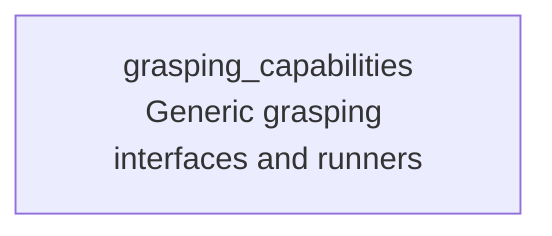

# grasping_capabilities

Provides reusable Capabilities2 runners and generic interfaces for grasping-stack motion, feasibility, pose state, and scene operations. Robot-specific plans, motion configuration, and application launch files belong in robot-specific capability packages.

`GraspingLaunchRunner` is the generic launch capability for `grasping_control/motion_execution.launch.py`. Applications can provide a specialized provider for that interface to select robot-specific motion settings and startup dependencies.

This package does not install plans, robot configuration, or a Fabric system launch wrapper.

## Capability inheritance



## Build

```bash
colcon build --packages-up-to grasping_capabilities --symlink-install
```